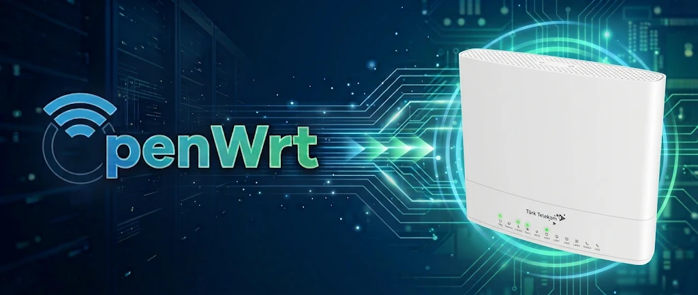

<p align="center">
  
</p>

# TP-Link EX20v v2 — OpenWrt Tool (macOS)

<p align="center">
  
  
  
  
</p>

A macOS tool to take a **full stock firmware backup**, **install OpenWrt**,
**manage the boot slot**, and **restore stock firmware** from the device's own
backup for the TP-Link EX20v v2. This is a **macOS port** of the Windows
`ex20v-tool.ps1`.

The command-line interface is **bilingual (English / Turkish)** — pick a
language when the tool starts.

> ⚠️ **This writes to flash memory. Misuse can brick the device.**
> You use it at your own risk. Your first action should be **1) Full backup**.

---

## Credits / Attribution

This macOS port is based on, and preserves attribution to, the original work:

- **Original tool (Windows / PowerShell):**
  https://github.com/yucellmustafa/tplink_ex20v_openwrt_tool — *yucellmustafa*
- The **OpenWrt project** and everyone who contributed EX20v v2 support.

The POSIX shell agent that runs on the device (`agent.sh`) is taken
**byte-for-byte from the original**
(`sha256: 465ad533bee82c43c89c5b7f4b42bd580d844d8a269aa7425c12bcbad0f72be6`).
Only the host (computer) side — the file server and SSH session handling —
was rewritten in Python for macOS. See [`NOTICE`](NOTICE) for the exact split
and [`LICENSE`](LICENSE) (MIT) for the port's terms.

This is an independent community effort with no affiliation to TP-Link,
Türk Telekom, EcoNet, MediaTek, or OpenWrt.

---

## Standalone — no installation required

`ex20v-tool` is a single self-contained macOS executable (built with
PyInstaller). You do **not** need to install Python, Homebrew or anything else
to run it. It uses macOS's own `ssh` / `tftp`.

Two builds are provided on the Releases page:

| Download | For |
|---|---|
| `ex20v-tool-macos-arm64.zip` | Apple Silicon (M1/M2/M3/…) |
| `ex20v-tool-macos-x86_64.zip` | Intel Macs |

Because it is unsigned, macOS Gatekeeper may block the first launch:

```sh
# remove the quarantine flag (inside the extracted folder)
xattr -dr com.apple.quarantine ex20v-tool
./ex20v-tool
```

Alternatively, right-click the file in Finder → **Open** and confirm.

The first time it opens a network server, the macOS firewall may ask to allow
incoming connections → **Allow**.

---

## Folder layout

```
ex20v-tool-macos/
├── ex20v-tool          ← the executable (run this)
├── files/              ← firmware images (must sit next to the tool)
│   ├── ex20v-rescue.bin
│   ├── ex20v-kernel.bin
│   ├── ex20v-ubi.bin
│   └── ex20v-v2-sysupgrade.bin
└── Backups/            ← backups are saved here (created automatically)
```

---

## Usage

```sh
./ex20v-tool            # port 8000 (default)
./ex20v-tool 8080       # different port
```

At startup, choose the interface language (English / Turkish). Menu:

1. **Take a full stock firmware backup** — read-only, no flash writes (~450 MB).
   *Do this first.*
2. **Install OpenWrt** (two steps)
   - 2A: Install rescue OpenWrt on the stock system
   - 2B: Install main OpenWrt once booted into rescue
3. **Restore stock firmware** (two steps) — uses the device's own backup
4. **Recovery and boot slot** — show / change the bootflag
5. **Check files and requirements** — read-only check

Root SSH access must be enabled on the stock firmware before the first install.

> **Note:** The on-device status messages streamed during an operation come from
> `agent.sh` (kept verbatim from upstream) and are in Turkish. The tool's own
> menus, prompts and errors follow the language you select.

### First safe test

Before writing anything to the device, verify the files with **5)**, then test
the read-only SSH connection with **4 → 1) Show status**. Neither touches flash.

---

## Build from source

```sh
sh build.sh          # Apple Silicon (arm64) → dist/ex20v-tool
sh build-x86.sh      # Intel (x86_64), cross-built on Apple Silicon via Rosetta 2
```

`build-x86.sh` cross-compiles the Intel binary on an Apple Silicon Mac: it
downloads a standalone x86_64 Python, runs PyInstaller under Rosetta 2, and
wraps `lipo`/`codesign` with shims that fall back to native arm64 (Rosetta's
`libxcrun` is arm64-only). Output: `dist-x86/ex20v-tool`, which runs natively
on Intel Macs.

Requirements (only to **build**): Python 3.9+, `pip`.

---

## Windows ↔ macOS differences

| Layer | Windows (`.ps1`) | macOS (this port) |
|---|---|---|
| Device agent | `agent.sh` (embedded) | **same** (`agent.sh`, embedded) |
| SSH client | Windows OpenSSH | macOS `ssh` |
| File download/upload | .NET HTTP/TFTP server | Python HTTP/TFTP server |
| SSH session | .NET Process + stdin state machine | `pexpect` PTY state machine |
| Agent transfer | chunked octal `printf` | **same method** + size verification |
| UI language | Turkish | **bilingual (EN / TR)** |

Before the agent is run, the size of the transferred `/tmp/x` is compared with
the expected size (fail-closed); on any mismatch no operation is started.

---

## License

MIT — see [`LICENSE`](LICENSE). The MIT license covers the macOS port code only.
`agent.sh` and `files/` come from the upstream project; see [`NOTICE`](NOTICE).
